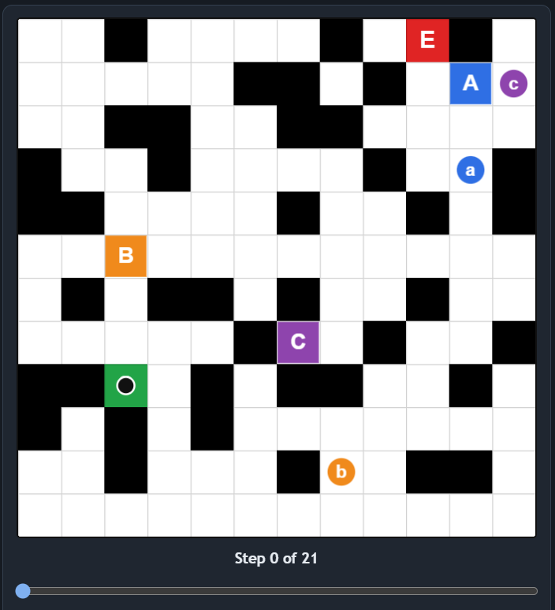
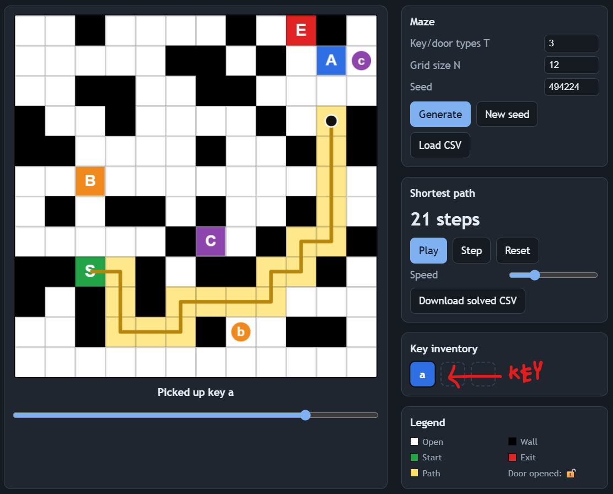
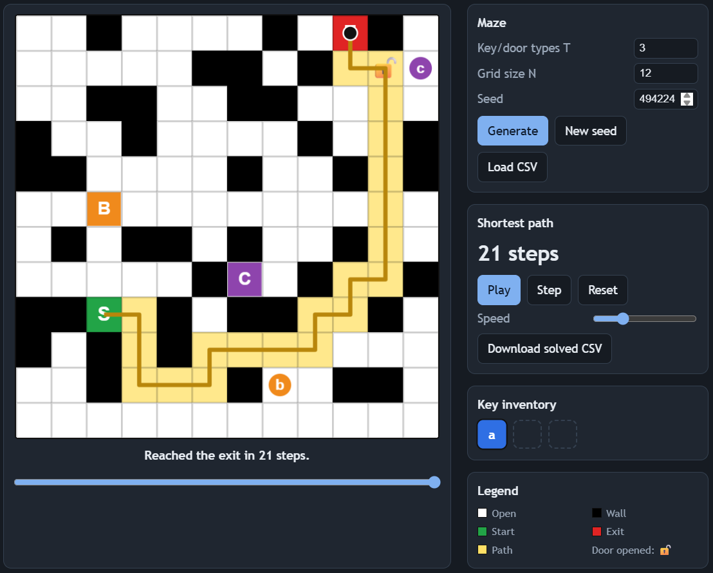
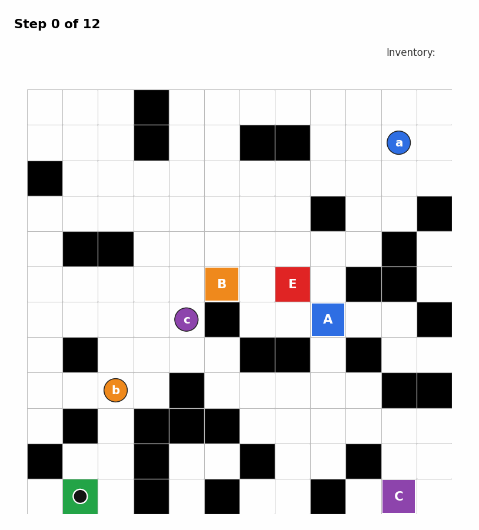

# Maze with Keys and Doors

A shortest-path maze solver using **Breadth-First Search (BFS)**, where players must collect keys to unlock matching doors and reach the exit. The project includes a Python solver, random maze generation, CSV input/output, and an interactive animated visualization.

## Problem Statement

Given an `N × N` grid, find the shortest path from the starting cell `S` to the exit `E`.

| Symbol | Description |
|:---:|---|
| `.` | Open cell |
| `#` | Wall |
| `S` | Starting position |
| `E` | Exit |
| `a`–`f` | Keys collected automatically |
| `A`–`F` | Doors requiring matching keys |

Movement is allowed in four directions: up, down, left, and right. Each move costs one step, and collected keys are never consumed.

### Input

- `T`: Number of key/door types (`1 ≤ T ≤ 6`).
- **CSV mode:** Load a maze from `maze.csv`.
- **Random mode:** Generate a random, solvable maze.

### Output

- Shortest path length, or `-1` if no path exists.
- `solved.csv` containing the shortest path marked with `x`.
- An interactive visualization with animated key pickups, door unlocking, and an inventory panel.

## Algorithm: Breadth-First Search

### Why BFS?

Ordinary BFS tracks only the current cell. In this maze, the ability to enter a cell also depends on the keys collected.

Therefore, each state contains three values:

```text
(row, column, key_mask)
```

The key mask is a bitmask representing collected keys. With at most six key types, there are only `2^6 = 64` possible masks.

### How It Works

1. Start BFS at `S` with an empty key mask.
2. Explore the four neighboring cells.
3. Reject moves outside the grid or into walls.
4. Enter a door only if its matching key has been collected.
5. Update the mask whenever a key is collected:

   ```python
   mask |= (1 << key_index)
   ```

6. Store parent states to reconstruct the shortest path.
7. Stop when the exit is reached.
8. Return `-1` if no valid route exists.

### Complexity Analysis

| Metric | Complexity |
|---|---|
| Time | `O(N² × 2^T)` |
| Space | `O(N² × 2^T)` |

For `N = 40` and `T = 6`, the maximum number of position-and-key states is `40 × 40 × 64 = 102,400`.

## Random Maze Generation

The generator:

1. Creates a grid with approximately 25% walls.
2. Places the start, exit, keys, and doors.
3. Runs BFS to verify solvability.
4. Prefers mazes whose shortest route uses at least one door.
5. Retries unsuccessful layouts and uses a fallback maze if necessary.

## Maze Visualizations

### 1. Input Maze

The original maze before solving.



### 2. Key Pickup

The player collects a key that can unlock its matching door.



### 3. Door Unlocked

The matching door changes appearance after it is unlocked.


### 4. Final Shortest Path

The shortest route from the start to the exit is highlighted.



### 5. Full Animation

Watch the maze solution, including movement, key collection, and door unlocking.



## Example Solved Maze

For the example maze with `T = 3`, the expected shortest path length is **12**.

The shortest route collects key `b`, passes through door `B`, and reaches the exit.

The resulting `solved.csv` marks ordinary path cells with `x`, while preserving special symbols.

```text
.,.,.,#,.,.,.,.,.,.,.,.
.,.,.,#,.,.,#,#,.,.,a,.
#,.,.,.,.,.,.,.,.,.,.,.
.,.,.,.,.,.,.,.,#,.,.,#
.,#,#,.,.,.,.,.,.,.,#,.
.,.,x,x,x,B,x,E,.,#,#,.
.,.,x,.,c,#,.,.,A,.,.,#
.,#,x,.,.,.,#,#,.,#,.,.
.,.,b,.,#,.,.,.,.,.,#,#
.,#,x,#,#,#,.,.,.,.,.,.
#,x,x,#,.,.,#,.,.,#,.,.
.,S,.,#,.,#,.,.,#,.,C,.
```

## Project Structure

```text
maze-with-keys-and-door/
├── maze_keys.py
├── maze_keys.html
├── make_images.py
├── maze.csv
├── solved.csv
├── README.md
└── images/
    ├── maze.png
    ├── key_pickup.png
    ├── door_unlocked.png
    ├── final_path.png
    └── animation.gif
```

## How to Run

### Requirements

- Python 3
- `matplotlib` and `pillow` for generating visualization images

### Option 1: Generate a Random Maze

```powershell
echo 3 | python maze_keys.py --n 12 --seed 7 --out solved.csv --save-maze maze.csv
```

### Option 2: Solve an Existing CSV Maze

```powershell
echo 3 | python maze_keys.py --csv maze.csv --out solved.csv
```

The program prints the shortest path length and saves the solution to `solved.csv`.

### Regenerate Images

```powershell
python make_images.py maze.csv
```

### Open the Interactive Visualization

1. Open `maze_keys.html` in your browser.
2. Click **Load CSV** to load a maze or **Generate** to create a random maze.
3. Click **Play** to watch the solution animation.

## Technologies Used

- **Python 3** — maze generation and shortest-path solver.
- **Breadth-First Search (BFS)** — shortest-path algorithm.
- **Bitmasking** — efficient key inventory representation.
- **HTML, CSS, JavaScript** — interactive visualization.
- **CSV** — maze input and solution output.
- **Matplotlib and Pillow** — visualization image generation.

## Key Features

- Shortest-path computation using BFS.
- Multiple keys and matching locked doors.
- Efficient state tracking with bitmasks.
- Random maze generation with solvability checks.
- CSV input and output.
- Interactive, animated browser visualization.
- Visual key collection and door unlocking.
- Path reconstruction using parent states.

## Author
1CR24CS164 - Saquib Eqbal
1CR24CS158 - Saksham Abrol
Created as a project demonstrating graph traversal, state-space search, bitmasking, and interactive visualization.
-
